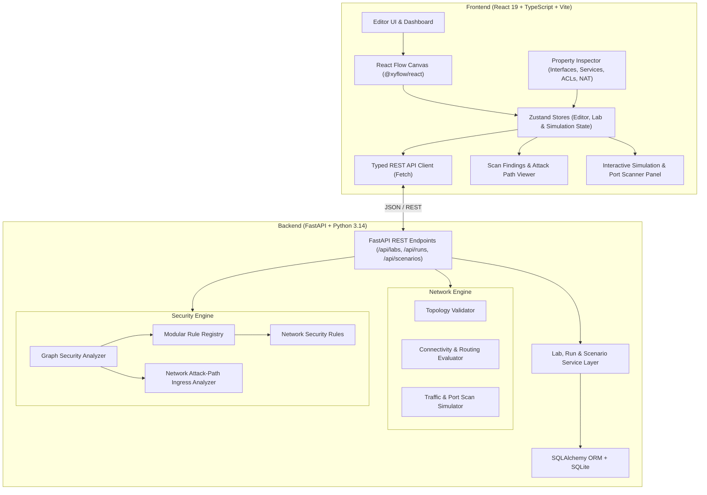
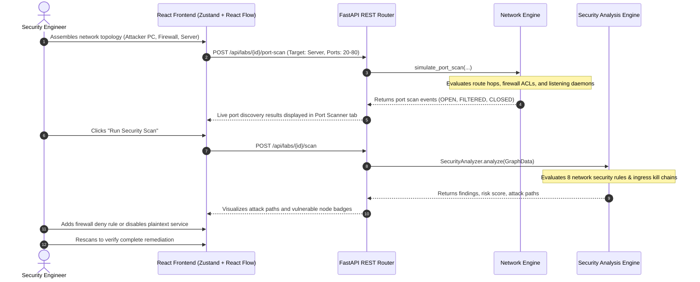

# RedLab — Architecture & System Design Document

**Version:** 1.1.0  
**Status:** Functional  
**Target Architecture:** Visual Network Security & Attack Simulation Platform  

---

## 1. Executive Summary

RedLab is an interactive, browser-based visual network attack simulation and defense laboratory inspired by Cisco Packet Tracer. Users visually construct computer network topologies on a canvas (PCs, Routers, Switches, Servers, Firewalls, External WAN), configure network interfaces, IP addresses, running services, and firewall ACLs, simulate packet traffic, conduct live TCP port scans, inspect network events, and evaluate deterministic network security rules that detect attack surfaces and multi-hop attack paths.

---

## 2. System Architecture Overview



---

## 3. Data Flow & Execution Model

The lifecycle of a network attack simulation follows a deterministic pipeline:



---

## 4. Component Breakdown

### 4.1 Frontend Presentation & Canvas (`frontend/`)

- **State Management (`src/stores/`):**
  - `editorStore.ts`: Coordinates canvas nodes, edges, selection, and security scan results.
  - `labStore.ts`: Manages laboratory CRUD, imports/exports, and persistence.
  - `simulationStore.ts`: Manages live ICMP ping traces, port scans, and packet event logs.
- **Visual Canvas (`src/features/editor/`):**
  - `EditorCanvas.tsx`: Built on `@xyflow/react`. Implements node connections, drag-and-drop ingestion, snapping, and link validation guards.
  - `ResourceNode.tsx`: Renders network device nodes with IP badges, running service counts, directional handles, and alert indicators.
  - `PropertyInspector.tsx`: Dynamic form inspector for IP interfaces, default gateways, server running services, firewall inbound ACLs, router NAT, and switch VLANs.
- **Simulation & Security (`src/features/simulation/`, `src/features/security/`):**
  - `SimulationPanel.tsx`: Collapsible bottom panel with interactive Ping test, Port Scanner tool, and live Network Traffic Event log.
  - `ScanPanel.tsx`: Security audit drawer displaying risk score, severity breakdown, finding cards, and multi-hop attack paths.

### 4.2 Backend REST Engine (`backend/`)

- **FastAPI Core (`app/main.py`, `app/api/`):**
  - `/api/labs`: Lab CRUD, import, export, and security scan trigger.
  - `/api/runs`: Interactive simulation execution (pings, port scans, packet trace generation).
  - `/api/scenarios`: Built-in guided training challenges and automated objective assessment.
- **Network Engine (`app/network_engine/`):**
  - `topology.py`: Deep topology validation (duplicate IDs, IP formatting, prefix validity, isolated devices).
  - `connectivity.py`: Pathfinding, Layer 2/3 forwarding, router next-hop selection, and firewall ACL matching.
  - `simulator.py`: Deterministic traffic simulation, ICMP packet generator, and TCP port scanner.
- **Security Engine (`app/security_engine/`):**
  - Modular `SecurityRule` base class and `RuleRegistry`.
  - 8 deterministic network rules evaluating WAN exposure, firewall policies, unencrypted ports, and missing segmentation.
  - Ingress attack path synthesizer tracing external attacker entry points to vulnerable internal targets.

---

## 5. Domain Schema & Graph Representation

### Network Node Definition
```json
{
  "id": "srv-prod",
  "type": "server",
  "label": "Production Web & DB Server",
  "position": { "x": 300, "y": 200 },
  "config": {
    "name": "Production Web & DB Server",
    "ip_address": "192.168.1.50",
    "cidr_prefix": "24",
    "default_gateway": "192.168.1.1",
    "services": [
      { "name": "HTTP", "port": 80, "protocol": "TCP", "status": "running" },
      { "name": "MySQL", "port": 3306, "protocol": "TCP", "status": "running" },
      { "name": "SSH", "port": 22, "protocol": "TCP", "status": "running" }
    ]
  }
}
```

### Edge Definition & Relationship Semantics
All physical and logical connections between devices use the canonical link relationship:
- `connects`: Layer 2/3 network link between two compatible network devices (PC, Router, Switch, Server, Firewall, External WAN).

---

## 6. Security & Educational Isolation Boundaries

1. **Self-Contained Local Simulation:** RedLab executes entirely offline in memory. No real external sockets or exploits are launched.
2. **Deterministic Evaluation:** Simulation events, port scans, and rule audits are completely reproducible and derived from the topological state graph.
3. **Local Persistence:** Laboratories and runs are safely stored in local SQLite (`backend/redlab.db`).
