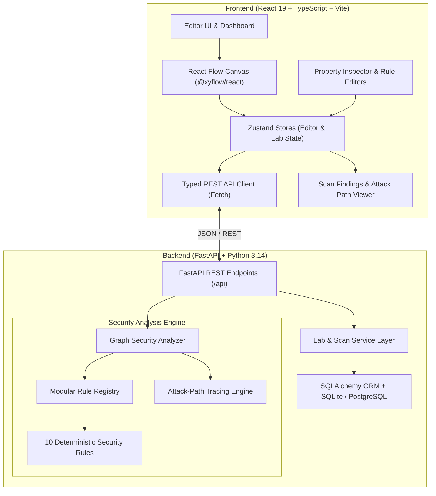

# RedLab — Architecture & System Design Document

**Version:** 1.0.0  
**Status:** Functional MVP  
**Target Architecture:** Multi-tier Cloud Security Simulation Platform  

---

## 1. Executive Summary

RedLab is an interactive, browser-based cloud security laboratory inspired by Cisco Packet Tracer. Users visually assemble AWS cloud architectures on a canvas, configure node attributes, connect resources with typed relationships, and execute a deterministic Python security engine that pinpoints security misconfigurations, calculates contextual risk scores, and reconstructs multi-stage attack paths.

---

## 2. System Architecture Overview



---

## 3. Data Flow & Execution Model

The lifecycle of an infrastructure simulation lab follows a strict deterministic pipeline:

```mermaid
sequenceDiagram
    autonumber
    actor User as Student / Engineer
    participant FE as React Frontend (Zustand + React Flow)
    participant API as FastAPI REST Router
    participant DB as SQLite Storage
    participant SEC as Security Analysis Engine

    User->>FE: Drags resource onto canvas (e.g. S3, EC2, SG)
    FE->>FE: Validates connection topology
    FE->>FE: Updates local graph state & marks unsaved changes
    User->>FE: Clicks "Run Security Scan"
    FE->>API: PUT /api/labs/{id} (Synchronizes current graph)
    API->>DB: Persists Lab with updated GraphData JSON
    FE->>API: POST /api/labs/{id}/scan
    API->>SEC: SecurityAnalyzer.analyze(GraphData)
    Note over SEC: Evaluates all 10 registered security rules
    Note over SEC: Synthesizes risk score & detects attack chains
    SEC-->>API: Returns findings, risk score, attack paths
    API->>DB: Stores ScanResult in database
    API-->>FE: 200 OK with ScanResponse schema
    FE->>User: Displays badges on canvas, findings list & attack path steps
    User->>FE: Fixes misconfiguration (e.g. disables public access)
    User->>FE: Clicks "Run Security Scan"
    Note over FE,SEC: Rescan produces 0 findings; issue badge disappears
```

---

## 4. Component Breakdown

### 4.1 Frontend Presentation & Canvas (`frontend/`)

- **State Management (`src/stores/`):**
  - `editorStore.ts`: Coordinates canvas nodes, edges, active selection, dirty state, and scan results. Maintains bidirectional translation between React Flow's layout coordinate model and RedLab's domain schema.
  - `labStore.ts`: Manages asynchronous project CRUD, laboratory listings, renaming, and persistence.
- **Visual Canvas (`src/features/editor/`):**
  - `EditorCanvas.tsx`: Built on `@xyflow/react`. Implements custom node types, drag-and-drop ingestion, snapping, zoom/pan navigation, and connection validation guards.
  - `ResourceNode.tsx`: Custom React Flow node providing directional handles, icon badges, labels, and real-time finding count alert chips.
  - `PropertyInspector.tsx`: Dynamic right-hand panel rendering context-specific forms for VPCs, Subnets, EC2 instances, S3 buckets, RDS databases, IAM roles, and Security Groups.
- **Security Presentation (`src/features/security/`):**
  - `ScanPanel.tsx`: Collapsible bottom drawer displaying severity breakdown chips, overall risk gauge, and tabbed views for individual findings and lateral attack paths.
  - `FindingCard.tsx`: Interactive accordion detailing rule ID, affected resource, technical impact, recommended remediation, and AWS documentation links.
  - `AttackPathView.tsx`: Step-by-step visual chain demonstrating how public entry points bridge to sensitive internal workloads through misconfigured credentials.

### 4.2 Backend REST Engine (`backend/`)

- **FastAPI Core (`app/main.py`, `app/api/`):**
  - Structured route handlers with automated Swagger UI documentation at `/api/docs`.
  - Strict input sanitization via Pydantic V2 models.
  - Robust exception handlers returning standard RFC-7807/FastAPI error envelopes.
- **Persistence Layer (`app/models/`, `app/core/database.py`):**
  - SQLAlchemy 2.0 Declarative ORM.
  - `Lab`: Stores laboratory metadata, canvas geometry, and typed node configurations in JSON columns.
  - `ScanResult`: Stores historical audit trails, passed/failed counters, findings array, and risk score metrics.

### 4.3 Security Analysis Engine (`backend/app/security_engine/`)

- **Registry Pattern (`registry.py`):**
  - Abstract base class `SecurityRule` with required properties (`rule_id`, `title`, `severity`, `category`) and interface `evaluate(graph: GraphData) -> list[Finding]`.
  - Extensible `RuleRegistry` allows registering new rules with zero modifications to the core analyzer.
- **Analyzer (`analyzer.py`):**
  - Iterates over registered rules against normalized graph inputs.
  - Computes deterministic risk scores:
    $$\text{Risk Score} = \min\left(100.0, \; \frac{\sum w_i}{\text{Total Rules} \times 10} \times 100\right)$$
    where $w_{\text{critical}}=10$, $w_{\text{high}}=7$, $w_{\text{medium}}=4$, $w_{\text{low}}=1$.
  - Executes lateral movement and privilege escalation analysis across graph edges.

---

## 5. Domain Schema & Graph Representation

### Node Definition
```json
{
  "id": "ec2-web",
  "type": "ec2",
  "label": "Web Server",
  "position": { "x": 120, "y": 80 },
  "config": {
    "name": "Web Server",
    "instance_type": "t3.micro",
    "subnet_id": "subnet-public-1",
    "security_group_ids": ["sg-public-web"],
    "public_ip": true,
    "iam_role_id": "iam-admin"
  }
}
```

### Edge Definition & Relationship Semantics
Visual edges represent specific domain associations rather than generic connections:
| Relationship Type | Source | Target | Semantic Meaning |
| :--- | :--- | :--- | :--- |
| `contains` | Subnet | VPC | Network partitioning boundary |
| `contains` | EC2 / RDS | Subnet | Workload placement in subnet |
| `attaches` | Internet Gateway | VPC | Public gateway route attachment |
| `attaches` | Security Group | EC2 / RDS | Stateful firewall assignment |
| `references` | IAM Role | EC2 | Instance profile credential association |

---

## 6. Security & Isolation Boundaries

1. **No External Cloud Execution:** RedLab operates purely in simulation. No real AWS resources are spun up, no credentials are authenticated against external APIs, and no cost is incurred.
2. **Deterministic Evaluation:** Rule outcomes depend exclusively on the explicit properties and topological connections declared on the canvas.
3. **Safe Storage:** SQLite database runs locally (`backend/redlab.db`) with transactional rollbacks, preventing partial or corrupt states.
