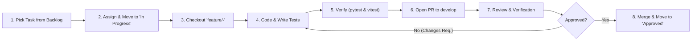

# RedLab — Project Management & Engineering Workflow System

Welcome to the RedLab project management system. This directory defines the operational framework, master roadmap, actionable task inventory, quality criteria, and review processes that coordinate the 6-member engineering team.

---

## 1. Quick Navigation

| Document | Purpose |
| :--- | :--- |
| **[ROADMAP.md](file:///Users/tiki/redlab/project-management/ROADMAP.md)** | Strategic milestones (M1 through M8) tracking past releases, active goals, and future capabilities. |
| **[TASKS.md](file:///Users/tiki/redlab/project-management/TASKS.md)** | Master inventory of actionable engineering tasks (`RL-001` to `RL-033+`) with GitHub Issue mappings. |
| **[DEFINITION-OF-DONE.md](file:///Users/tiki/redlab/project-management/DEFINITION-OF-DONE.md)** | Non-negotiable quality criteria required before any pull request is merged. |
| **[REVIEW-PROCESS.md](file:///Users/tiki/redlab/project-management/REVIEW-PROCESS.md)** | Step-by-step lifecycle from backlog triage to branch creation, code review, verification, and merge. |
| **[CONTRIBUTING.md](file:///Users/tiki/redlab/project-management/CONTRIBUTING.md)** | Branching strategies, conventional commit formats, code conventions, and PR expectations. |
| **[SECURITY-REQUIREMENTS.md](file:///Users/tiki/redlab/project-management/SECURITY-REQUIREMENTS.md)** | Threat model, sandbox isolation specifications, network controls, and zero-secrets policies. |
| **[templates/](file:///Users/tiki/redlab/project-management/templates/)** | Offline markdown templates for tasks, features, bugs, and pull requests. |

---

## 2. Team Structure & Domain Ownership

To prevent overlapping edits and merge conflicts, each member operates within dedicated subsystem boundaries:

```
                                  ┌─────────────────────────────┐
                                  │      Team Lead (Owner)      │
                                  │ Architecture & Integrations │
                                  └──────────────┬──────────────┘
                                                 │
          ┌─────────────────┬────────────────────┼───────────────────┬─────────────────┐
          │                 │                    │                   │                 │
┌─────────┴─────────┐ ┌─────┴───────────┐ ┌──────┴──────────┐ ┌──────┴─────────┐ ┌─────┴───────────┐
│       Dev 1       │ │      Dev 2      │ │      Dev 3      │ │      Dev 4      │ │      Dev 5      │
│  Visual Canvas &  │ │ Inspector, UI & │ │ Security Engine │ │ Backend API &   │ │ QA, Testing &   │
│   Graph Engine    │ │    Dashboard    │ │   & Sandboxes   │ │ Data Storage    │ │   DevSecOps     │
└───────────────────┘ └─────────────────┘ └─────────────────┘ └─────────────────┘ └─────────────────┘
```

| Role | Primary Domain | Core Directories / Files | Branch Prefix |
| :--- | :--- | :--- | :--- |
| **Lead (Owner)** | System Architecture, Schemas, Release Management | `app/schemas/`, `types/index.ts`, `docs/`, `project-management/` | `main`, `develop`, `release/*` |
| **Dev 1** | Visual Canvas, React Flow, Graph Geometry | `frontend/src/features/editor/EditorCanvas.tsx`, `ResourceNode.tsx` | `feature/canvas-*` |
| **Dev 2** | Inspector, Forms, Modals, Navigation | `frontend/src/features/editor/PropertyInspector.tsx`, `features/dashboard/` | `feature/ui-*` |
| **Dev 3** | Security Rules, Detection, Attack Engine | `backend/app/security_engine/`, sandbox controllers | `feature/security-*` |
| **Dev 4** | FastAPI Routers, SQLAlchemy, Persistence | `backend/app/api/`, `backend/app/models/`, `backend/app/services/` | `feature/backend-*` |
| **Dev 5** | QA, Automated Testing, CI/CD, Sandboxing | `backend/tests/`, `frontend/src/test/`, `.github/workflows/` | `feature/qa-*`, `test/*` |

---

## 3. Daily Developer Lifecycle



1. **Pick an assigned task:** Locate your task in `TASKS.md` or the GitHub Issues backlog.
2. **Assign yourself:** Claim the GitHub Issue and move its status to `In Progress`.
3. **Branch from `develop`:** Create your isolated branch following `feature/<role>-<topic>`.
4. **Implement incrementally:** Build the feature or fix while keeping changes scoped to your domain.
5. **Verify locally:** Run full test suites (`python3 -m pytest backend/tests/ -v` and `cd frontend && npm test && npm run build`).
6. **Open PR:** Target `develop` using the Pull Request template. Link the issue (`Closes #<ID>`).
7. **Peer Review:** Address review comments, ensure CI passes, and verify functional acceptance criteria.
8. **Merge & Complete:** Merged via squash/rebase into `develop`; close issue and celebrate.

---

## 4. GitHub Issue & Milestone Management

RedLab uses GitHub Issues and Milestones for real-time tracking:
- **Milestones:** Align with `ROADMAP.md` (Milestones 1 through 8).
- **Labels:**
  - Priority: `priority:P0` (Blocker), `priority:P1` (High), `priority:P2` (Medium), `priority:P3` (Low).
  - Subsystems: `area:frontend`, `area:backend`, `area:database`, `area:simulation`, `area:security`, `area:devops`, `area:documentation`, `area:architecture`.
  - Workflow State: `status:backlog`, `status:assigned`, `status:in-progress`, `status:needs-review`, `status:approved`.

---

## 5. Setting Up the GitHub Projects Board

To configure the team's visual Kanban board on GitHub:

### Option A: Via GitHub CLI (Recommended)
1. Request the `project` scope:
   ```bash
   gh auth refresh -s project,read:org
   ```
2. Create the board:
   ```bash
   gh project create --owner cooler-ctrl --title "RedLab Project Management"
   ```
3. Configure the Kanban columns:
   - `Backlog`
   - `Assigned`
   - `In Progress`
   - `In Review`
   - `Changes Requested`
   - `Approved`

### Option B: Via Web UI
1. Navigate to **[GitHub Projects](https://github.com/users/cooler-ctrl/projects)**.
2. Click **New project** $\rightarrow$ Select **Board** template.
3. Title the project **RedLab Engineering Board**.
4. Link repository: `cooler-ctrl/Red-Lab`.
5. Set columns to match the workflow: `Backlog`, `Assigned`, `In Progress`, `In Review`, `Changes Requested`, `Approved`.
