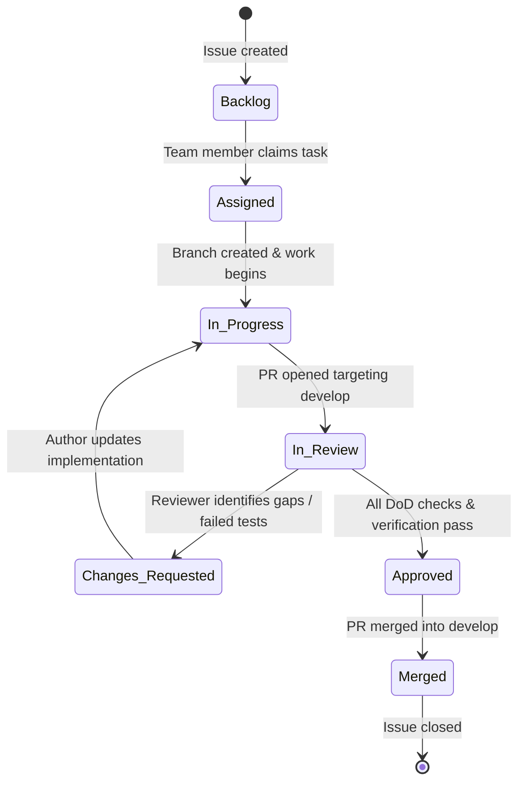

# RedLab — Code Review & Quality Assurance Workflow

This document defines the review and approval process governing all contributions to RedLab. Our process guarantees high code quality, consistent architectural design, deterministic security rules, and reliable releases.

---

## 1. Task Lifecycle Overview



---

## 2. Step-by-Step Review Workflow

### Phase 1: Task Selection & Assignment (`Backlog` $\rightarrow$ `Assigned`)
1. Tasks reside in the `Backlog` column on GitHub Projects or `project-management/TASKS.md`.
2. A developer selects a task aligned with their designated domain role (see `TEAM_WORKFLOW.md`).
3. The developer assigns themselves to the GitHub Issue and moves the card to `Assigned`.

### Phase 2: Implementation & Local Validation (`Assigned` $\rightarrow$ `In Progress`)
1. Ensure local `develop` branch is up to date:
   ```bash
   git checkout develop
   git pull origin develop
   ```
2. Branch using your domain prefix:
   ```bash
   git checkout -b feature/<role>-<short-description>
   ```
3. Implement the changes following established conventions.
4. Execute full local verification:
   ```bash
   # Backend checks
   cd backend && python3 -m pytest tests/ -v
   
   # Frontend checks
   cd ../frontend && npm test && npm run build
   ```
5. Commit using Conventional Commits (`feat:`, `fix:`, `test:`, `docs:`, `refactor:`).

### Phase 3: Submission & Automated CI (`In Progress` $\rightarrow$ `In Review`)
1. Push your branch to GitHub:
   ```bash
   git push -u origin feature/<role>-<short-description>
   ```
2. Open a Pull Request targeting **`develop`** (never directly into `main`).
3. Fill out the Pull Request template completely:
   - Reference the issue number (`Closes #RL-xxx`).
   - Summarize functional changes and design decisions.
   - Attach test execution output, screenshots, or logs.
   - Complete the Definition of Done checklist.
4. Move the GitHub Issue to `In Review` and assign the designated subsystem reviewer or Lead.

### Phase 4: Peer Review & Verification
1. **Automated Checks:** All CI workflows (linting, tests, build verification) must complete with green checkmarks.
2. **Reviewer Inspection:**
   - **Architectural Conformance:** Verifies directory boundaries and guardrails in `AGENTS.md`.
   - **Schema Drift:** Checks that backend Pydantic models and frontend TypeScript types remain identical.
   - **Deterministic Security:** Verifies that any new security rule subclasses `SecurityRule` with positive and negative unit tests.
   - **Functional Verification:** Reviewer tests the feature locally or inspects test evidence. Passing tests alone do not prove completeness if edge cases were omitted.
3. **Outcomes:**
   - **Approve:** All acceptance criteria are met, code is clean, tests pass.
   - **Request Changes:** Reviewer leaves specific, actionable comments linking to lines of code.

### Phase 5: Addressing Changes (`Changes Requested` $\rightarrow$ `In Progress`)
1. If changes are requested, the author moves the task back to `In Progress`.
2. The author implements the feedback on the same branch.
3. The author pushes additional commits and leaves comment replies explaining how each review point was resolved.
4. The author requests re-review.

### Phase 6: Merge & Completion (`Approved` $\rightarrow$ `Merged`)
1. Once approved, **Pashtrik Maliqi (@cooler-ctrl)** (Lead Architect & Owner) merges the PR using **Squash and Merge** or **Rebase and Merge** to maintain a clean git history. No other team member is authorized to merge into `main` or `develop`.
2. The author deletes the remote feature branch.
3. The linked GitHub Issue is automatically closed and marked `Approved`.

---

## 3. GitHub Branch Protection Settings (Enforced)

To ensure the review process is strictly enforced, branch protection rules are configured on `cooler-ctrl/Red-Lab` for `main` and `develop`:

> **EXCLUSIVE LEAD APPROVAL POLICY:**  
> All PRs targeting `main` require approval from Code Owner **Pashtrik Maliqi (@cooler-ctrl)** per `.github/CODEOWNERS`. Direct pushes to `main` are blocked.

### Target Branch: `main` & `develop`
1. **Require a pull request before merging:**
   - Minimum required approvals: **1 reviewer**.
   - Dismiss stale pull request approvals when new commits are pushed: **Enabled**.
   - Require review from Code Owners (`@cooler-ctrl`): **Enabled**.
2. **Require status checks to pass before merging:**
   - Require branches to be up to date before merging: **Enabled**.
   - Required status checks:
     - `backend-checks` (Pytest)
     - `frontend-checks` (Vitest + TypeScript build)
3. **Require conversation resolution before merging:** **Enabled**.
4. **Require signed commits:** Recommended.
5. **Direct pushes blocked:** Only PRs reviewed and approved by Pashtrik Maliqi can be merged.
